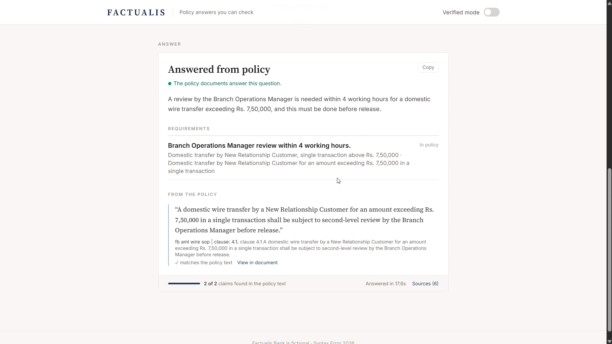
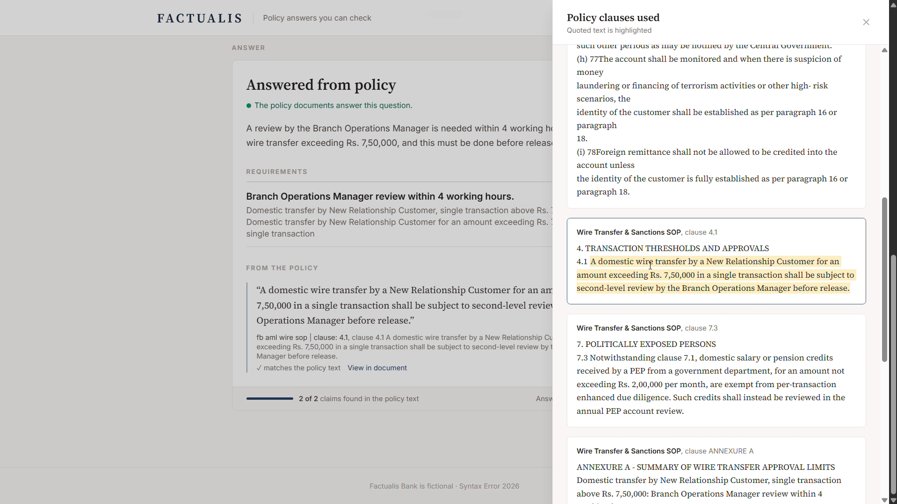
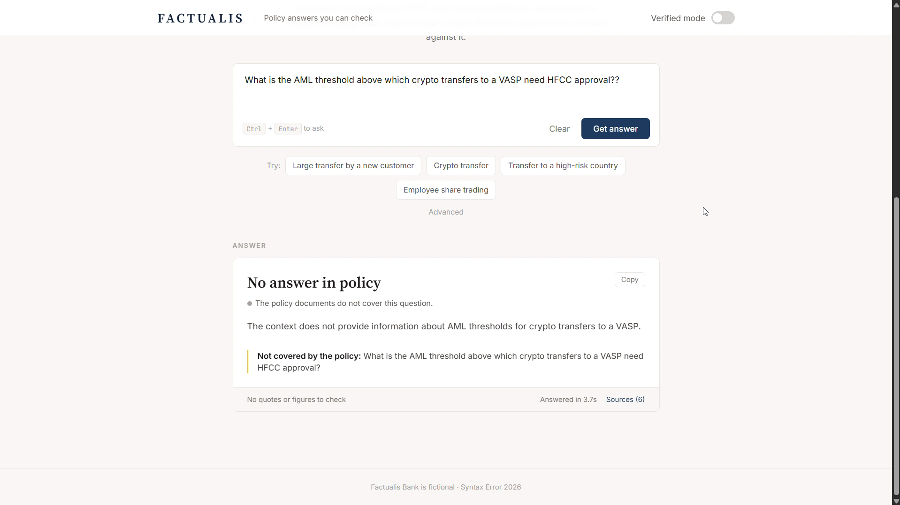
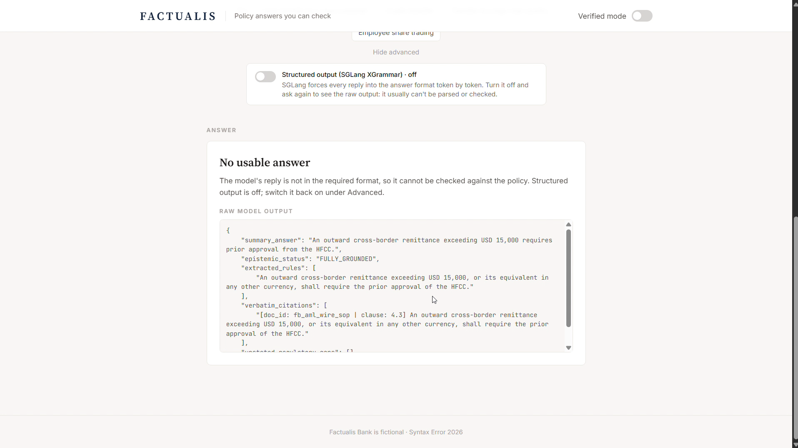
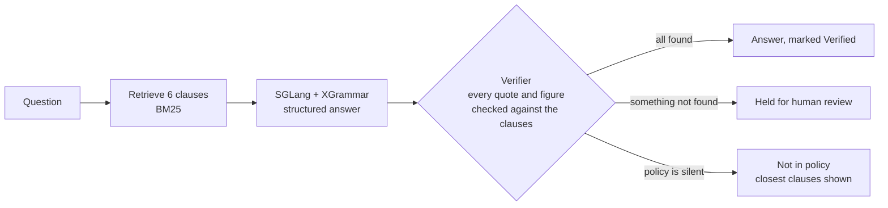
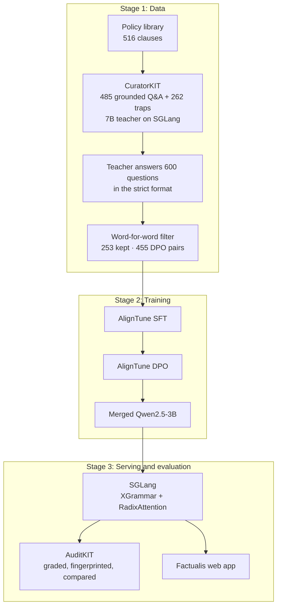

<div align="center">

# FACTUALIS

### Compliance answers you can check

A 3-billion-parameter model that answers bank-compliance questions **only from the bank's own policies**, quotes the exact clause, says so when the policy is silent, and has **every quote and figure verified word for word** before anyone sees it. Runs locally on one T4 GPU.

**Team Gowardhan Gheeks** · Syntax Error 2026 · Local LLM Track (RadixArk × Lexsi Labs) · Problem Statement 3: *Grounded answers and fewer hallucinations*


[**Technical report (PDF)**](docs/Factualis_Technical_Report.pdf) · [**Demo video**](https://drive.google.com/file/d/1opSN-g1zy9QP-Ob5E74osOKGf28nuZfF/view?usp=sharing) · [**Results**](results/)

</div>

---

## At a glance

| | |
|:--|:--|
| **0% → 100%** | answers in a valid, checkable format, without vs with SGLang structured output |
| **9.3× faster** | time to first token with RadixAttention when questions share policy text (2.25 s → 0.24 s) |
| **9.2%** | of a 7B teacher's answers contained a fabricated quote or figure; our filter caught every one before training |
| **−38%** | fewer wrong refusals after SFT + DPO (28.4% → 17.6%, p = 0.02) |
| **0.38 → 0.20** | unsupported claims per answer, base vs fine-tuned |
| **94** | hand-verified test questions, including traps and two documents never seen in training |

## Screenshots

| Answer grounded in policy | Clause with the quote highlighted |
|:-:|:-:|
|  |  |
| **Trap question refused** | **Structured output off** |
|  |  |

## The problem

Ask a general-purpose model:

> *"A customer who opened her account two months ago wants to RTGS Rs 9 lakh. What review is needed?"*

It will answer instantly and confidently from what it already knows: a US USD 10,000 rule, a five-year retention period, an approver this bank doesn't have. In compliance, that isn't a typo, it's a breach.

Factualis is built around one rule: **if a claim can't be traced to a clause, it isn't shown as an answer.**

## What it looks like

These are real outputs from our final evaluation, abridged.

**An answerable question.** The quote is copied character for character from clause 4.1 of the bank's Wire Transfer SOP, and the verifier confirms it.

```json
{
  "summary_answer": "A review by the Branch Operations Manager is needed within 4 working hours for a domestic wire transfer exceeding Rs. 7,50,000, and this must be done before release.",
  "epistemic_status": "FULLY_GROUNDED",
  "verbatim_citations": [{
    "exact_quote": "A domestic wire transfer by a New Relationship Customer for an amount exceeding Rs. 7,50,000 in a single transaction shall be subject to second-level review by the Branch Operations Manager before release."
  }]
}
```

**A trap question.** It names a real approver from our procedures, but crypto is outside the bank's policies, so the model refuses instead of inventing a threshold.

```json
{
  "summary_answer": "The context does not provide information about AML thresholds for crypto transfers to a VASP.",
  "epistemic_status": "ABSTAIN_NOT_IN_POLICY",
  "extracted_rules": [],
  "verbatim_citations": []
}
```

## How it works



1. **A policy library built to expose hallucinations.** Factualis Bank is fictional. Its library mixes three real Indian regulations (RBI KYC Master Direction, PML Rules, SEBI insider trading regulations) with three internal procedures we wrote with deliberately unusual thresholds: Rs 7.5 lakh review, USD 15,000 approval, 8-year retention. An answer from general knowledge is easy to catch.
2. **A fixed answer format, enforced while decoding.** Summary, status, extracted rules, verbatim citations and the parts the policy doesn't cover. SGLang's XGrammar backend makes it impossible for the model to answer in free text.
3. **A verifier, not a judge.** Quotes must appear verbatim in the retrieved clauses and figures must appear in them too. A short program checks this, with no second model involved. The same checks filter the training data, score the evaluation and power Verified mode in the app.

## The pipeline, and where each track tool fits



| Stage | Tool | What it does in Factualis |
|---|---|---|
| Data | **CuratorKIT** + **SGLang** | A 7B teacher served by SGLang generates grounded questions and near-miss trap questions from the policy clauses, with CuratorKIT's hallucination and reward filters |
| Data | Our verifier | The teacher answered 600 questions and only 253 passed the word-for-word check. Each DPO pair puts a verified answer against a copy with exactly one fact broken: wrong threshold, dropped condition, reworded quote, false refusal or answered trap |
| Training | **AlignTune** | SFT on 253 verified answers, then DPO on 455 pairs, on one T4 (Unsloth, 4-bit LoRA, fp16). DPO reached 92.5% preference accuracy |
| Serving | **SGLang** | XGrammar structured output, RadixAttention prefix caching, OpenAI-compatible API behind the website |
| Evaluation | **AuditKIT** | Every run graded and fingerprinted; base and fine-tuned models compared question by question with paired significance tests |

## Results

All numbers are on 94 hand-verified questions: 41 answerable, 20 traps that must be refused, 15 partly answerable and 18 with conflicting rules. Two documents were held out of training entirely.

**Base vs fine-tuned (final evaluation, graded by AuditKIT)**

| Metric | Base Qwen2.5-3B | SFT + DPO | p |
|---|:-:|:-:|:-:|
| Answerable questions wrongly refused | 28.4% | **17.6%** | **0.02** |
| Unsupported claims per answer | 0.38 | **0.20** | 0.17 |
| Quotes copied verbatim | 70.6% | **83.9%** | – |
| Status accuracy | 52.1% | **57.4%** | 0.18 |
| Held-out documents: status accuracy | 26.7% | **46.7%** | 0.25 |
| Held-out documents: hallucination | 40.0% | **26.7%** | 0.63 |
| Answers with no unsupported claim | 77.7% | 77.7% | 1.00 |
| Usable and correct answers | 41.5% | 41.5% | 1.00 |
| Trap questions answered | **5%** | 15% | 0.50 |
| Status consistent with the answer | **95.7%** | 85.1% | **0.02** |

Fine-tuning made the model refuse less, claim less without support, quote more faithfully and generalise better to unseen documents. It also answered a couple more trap questions, so on the strictest combined measure the two tie, and the live demo serves the base model because it refuses traps more reliably.

**What we learned the hard way.** Our first training run made the model *worse*, and AuditKIT showed the drop was significant. The cause was the answer format, not the training: the summary was optional, and one field asked for labels the prompt never defined. The teacher copied both problems and fine-tuning amplified them, until the model left the summary empty in 94 of 94 answers. We fixed the format, enforced a minimum summary length during decoding and added usability checks. The same model's summaries came back (0% → 97.9%). The [report](docs/Factualis_Technical_Report.pdf) has the full analysis.

## Repository structure

```
Factualis/
├── factualis/                    core library
│   ├── answer_format.py            the structured answer the model must produce
│   ├── prompts.py                  system prompt and how clauses are shown to the model
│   ├── policy_library.py           clause splitting and BM25 retrieval
│   ├── verifier.py                 word-for-word checks and evaluation metrics
│   └── llm_client.py               client for the SGLang server
├── pipeline/                     one script per step
│   ├── download_regulations.py     fetch the public regulation PDFs
│   ├── build_policy_library.py     PDFs and procedures into clause-level JSONL
│   ├── test_set_tools.py           check test and seed questions against the clauses
│   ├── check_sglang_server.py      quick structured-output request to a running server
│   ├── build_training_data.py      teacher labelling, word-for-word filter, DPO pairs
│   ├── train.py                    SFT, DPO and adapter merging with AlignTune
│   ├── evaluate.py                 run a model on the test set and score it
│   ├── compare_with_auditkit.py    AuditKIT grading and base-vs-fine-tuned comparison
│   └── benchmark_prefix_cache.py   RadixAttention time-to-first-token benchmark
├── web/                          Factualis website
│   ├── app.py                      FastAPI backend
│   ├── answering.py                retrieval, model call and verification for each question
│   └── static/index.html           single-page frontend
├── configs/                      CuratorKIT pipelines (grounded Q&A, near-miss traps)
├── data/
│   ├── regulations/                RBI, PML and SEBI PDFs with their sources
│   ├── bank_procedures/            the three internal procedures
│   ├── policy_clauses.jsonl        516 clauses used for retrieval
│   ├── test_questions.jsonl        94 hand-verified test questions
│   ├── training_seed_questions.jsonl
│   └── question_generation_prompts/
├── notebooks/
│   ├── 1_full_pipeline.ipynb       curation, training and evaluation on one T4
│   └── 2_evaluation_and_demo.ipynb final evaluation and the website
├── results/
│   ├── initial_evaluation/         first run: predictions and AuditKIT comparison
│   └── final_evaluation/           final run: predictions, metrics and AuditKIT comparison
├── docs/                         technical report (PDF and HTML source)
├── tools/                        Colab packaging and report rendering
├── tests/                        unit tests
├── requirements.txt
└── README.md
```

## Run it

**On Colab (free T4).**

1. Build the code bundle, then upload `dist/factualis_colab.zip` to `MyDrive/Factualis/`:
   ```bash
   python -m tools.package_for_colab
   ```
2. Open [`notebooks/1_full_pipeline.ipynb`](notebooks/1_full_pipeline.ipynb), choose a T4 runtime and run all cells. It takes 6 to 8 hours and resumes after a disconnect.
3. Open [`notebooks/2_evaluation_and_demo.ipynb`](notebooks/2_evaluation_and_demo.ipynb) to run the final evaluation and start the website. It prints a public link at the end.

**On any machine, no GPU.** Run the unit tests and re-grade the saved results. The re-grade reproduces our numbers and AuditKIT fingerprints exactly.

```bash
pip install auditkit pydantic openai rank_bm25 pypdf pytest
```

```bash
python -m pytest tests
```

```bash
python -m pipeline.compare_with_auditkit --results-dir results/final_evaluation --out results/final_evaluation/regraded.md
```

## Limitations

- BM25 finds all of the needed evidence for 73% of answerable questions, so retrieval caps answer quality.
- The test set is small (20 traps, 15 held-out questions); that's why every comparison carries a paired significance test.
- The training data was generated with the original answer format. Relabelling it with the corrected format is the next experiment.

## Team

**Team Gowardhan Gheeks**, Syntax Error 2026, Local LLM Track.

Factualis Bank and its internal procedures are fictional and were written for this project. The RBI, PML and SEBI regulations are public documents.
